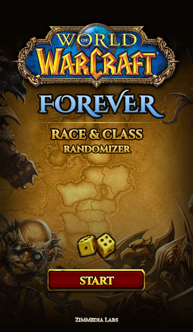
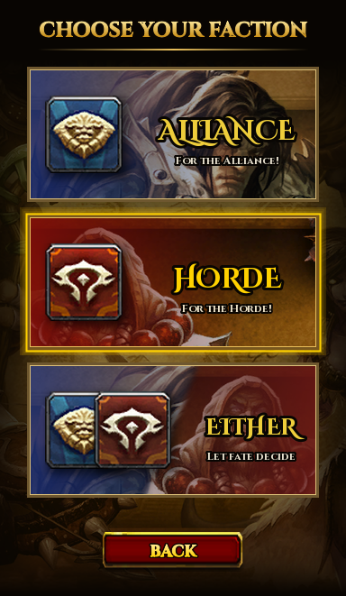
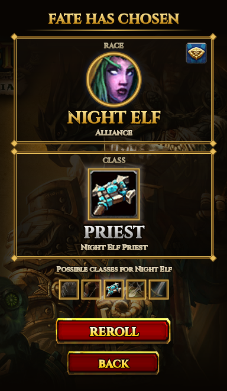

Made a WoW Forever Race & Class Randomizer after getting into the WoW Forever beta and not being able to decide what to roll. Same idea as my Diablo Class Randomizer, but this one picks your race first, then picks a class that race can actually play.

Pick Alliance, Horde, or Either and let fate decide. Can be used as Web App here: https://zimmworks.github.io/WoW-Forever-Randomizer/

- Works with all the WoW Forever races, including both Skyborne (High Order for Alliance, Windshaper for Horde)
- Reroll as many times as you want, it won't give you the same combo twice in a row
- Click anywhere while it's rolling to skip straight to the result
- Space/Enter to reroll, Esc to go back

   

Want your own sounds? Make a Sounds folder next to the .exe and drop in .wav files named click.wav, roll_start.wav, race_lock.wav, alliance_jobs_done.wav or horde_work_complete.wav.

All WoW art, icons and sounds belong to Blizzard. Fonts are Cinzel and Cinzel Decorative (SIL Open Font License, see Resources/Fonts/OFL.txt). Fan project, not affiliated with Blizzard.

---------------------------------------------------------------------------------------------------------------------------------------------

## 🛡️ Is this safe?

> [!IMPORTANT]
> **Totally fair question for any random .exe on the internet. Here's exactly what it does and doesn't do:**
>
> - ✅ **No internet connection**
> - ✅ **No admin rights, no installer, nothing added to the registry**
> - ✅ **Only writes one thing:** a copy of its fonts to your Temp folder so Windows can load them
> - ✅ **100% open source:** every line of code is right here in the repo
> - ✅ **Build it yourself if you'd rather:** the steps are below, and the result is the same app.

> [!NOTE]
> **Windows may show a SmartScreen warning** because the app isn't signed with a paid certificate. Click **More info → Run anyway**, or build it yourself:
> ```powershell
> git clone https://github.com/ZiMMworks/WoW-Forever-Randomizer
> cd WoW-Forever-Randomizer
> dotnet build WoWForeverRandomizer.csproj -c Release
> ```
